# bm — BareMetal Console & Game Engine

<p align="center">
  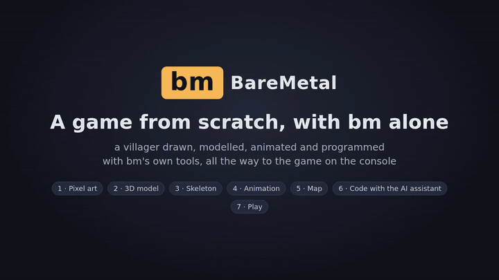
</p>

<p align="center">
  <b>A complete game from scratch, on bare-metal hardware alone</b> (16 s).<br>
  Map painting in SDK · code editor with AI assistant · live gameplay with skeletal animation.<br>
  <sub>Recorded in QEMU (<code>-M raspi0</code>) running the exact Raspberry Pi kernel binary. Rebuilt with <code>make showreel</code> · <a href="docs/showreel.mp4">MP4 1280×720</a></sub>
</p>

<p align="center">
  <a href="#-quick-start"></a>
  <a href="docs/API.md"></a>
  <a href="docs/progress.md"></a>
  <a href="LICENSE"></a>
</p>

---

## 🚀 Overview

**bm** (BareMetal) is an open-source games console and development environment. It runs on the **Raspberry Pi Zero W** (main target, also the other Pi 1 boards) and on the **PowKiddy RGB30** (`make TARGET=rgb30`) with **no underlying operating system**. The Pi Zero 2 W kernel (`kernel7.img`) is off in the default build.

Power on and the console boots straight into the games menu. Games are written in Lua 5.4, powered by a custom bare-metal runtime with 2D and 3D pipelines, V3D hardware rendering on the Pi, a polyphonic synthesizer, network multiplayer, and an on-device creative suite.

---

## ✨ Key Features

- **True Bare Metal Architecture**:
  - `kernel.img` (C, ARM assembly, and Lua 5.4) communicates directly with hardware registers. Size on 25 Oct 2026: about 4.5 MB for the Pi (`kernel.img`, with the editors built in) and about 2.3 MB for the RGB30 (`kernel8.img`).
  - No Linux kernel, background daemons, or OS scheduler: the 1 GHz core and the ARM share of the 512 MB RAM belong to your game frame (the share is read from the firmware: 448 MB with `gpu_mem=64`, see [`docs/HARDWARE.md`](docs/HARDWARE.md)).
- **Hardware & Peripherals**:
  - **Video**: HDMI output at 640×360, 480×270, 320×180, 256×256, 360×360 or 720×720 per cartridge, scaled up by the HDMI scaler ([`docs/RISOLUZIONI.md`](docs/RISOLUZIONI.md)).
  - **Audio**: 8-voice polyphonic synthesizer with HDMI digital audio output.
  - **Inputs**: USB keyboards, gamepads and mice, and Bluetooth (up to 4 DualShock 4 controllers, a BLE keyboard, a mouse).
  - **Connectivity**: WiFi with HTTPS, local UDP multiplayer, and FAT32 SD card file system.
- **Cartridge System (`.bm`)**:
  - A cartridge is one file in the `bm/` folder of the SD card: Lua source, sprite sheets, tile maps, 3D meshes, skeletal animations and sound banks ([`docs/BM-FORMAT.md`](docs/BM-FORMAT.md)).
  - The `.b16` is a second edition (360×360, same container) that runs on the Pi and on the RGB30. Today Yharnam, Overbit, Titan Clash EX and the RGB30 SDK ship as `.b16`. The plan to end it and keep one `.bm` is in [`docs/NEXT.md`](docs/NEXT.md) and [`docs/design/single-bm-and-adaptive-screen.md`](docs/design/single-bm-and-adaptive-screen.md). It is not built yet.
  - PICO-8 carts (`.p8`, `.p8.png`) play through the built-in `nano8` cartridge.
- **On-Console Creative Suite**:
  - Code, draw, sculpt 3D models, rig skeletons, compose music, and test games directly on the console with no PC required.

```lua
local x = 320
function _update()                       -- 60 fps fixed update
  if btn(0) then x = x - 2 end           -- Left pad / arrow
  if btn(1) then x = x + 2 end           -- Right pad / arrow
end

function _draw()
  cls(0x102030)
  spr(1, x, 180)                         -- Draw sprite from cartridge sheet
end
```

---

## ⚡ Performance Highlights

Hardware target: **Raspberry Pi Zero W** (ARM1176 @ 1.0 GHz, VideoCore IV V3D GPU). All numbers are from the 3D Bench reports of 22 and 24 Oct 2026, at 640×360 RGB565, and show what one 60 fps frame (16.6 ms) holds. The full tables, with the report of each number, are in [`docs/PERF-BUDGET.md`](docs/PERF-BUDGET.md). RGB30: not verified on hardware with the current drivers.

| Thing | One 60 fps frame holds |
|---|---:|
| Map layer, opaque, full screen (8×8 tiles) | 5 layers (3.08 ms each) |
| Sprites 16×16, ARM | 2,574 |
| Sprites 16×16, GPU in the 2D job | 3,569 or more |
| Hero of 1,536 triangles, GPU with vertex shader | 66 |
| Spheres of 96 faces, GPU with vertex shader | 783 |
| Draw calls (one cube each), GPU with vertex shader | 1,386 |
| Hero sets with map, 2D and logic (`herotris`), GPU + vertex shader + queue | 49,956 triangles (13.7 ms) |
| Hero Stress, 640×360, animated heroes | 50 heroes, 52,992 triangles (59-60 fps) |
| Hero Stress, 1080p | 24 heroes, 27,408 triangles (60 fps) |

The same `herotris` scene on the ARM rasterizer holds 2,385 triangles (40.8 ms).

### 🚀 3D Engine & Architecture (bm3d & V3D Driver)
bm integrates **bm3d** (version 7.7 in [`src/gpu/version3d.h`](src/gpu/version3d.h)), a dual-path 3D engine:
- **GPU Path (V3D Hardware - Default)** (`gpu3d`): the V3D fills pixels with custom QPU assembly shaders (`tools/qpuasm.py`) at **811 Mpixel/s** (full-screen render only). The vertex shader (`gpu3d_vs`, default 2) places the corners on the GPU. 4× MSAA is available (`gpu3d_aa`, off by default). The 2D draws in the same GPU job (`gpu3d_2d`, on by default).
- **ARM Fallback Rasterizer** (`r3d`): software rasterizer with per-face LOD, screen-door transparency, and planar shadows, used when the GPU is absent or in emulators.
- **Settings > Screen** shows two graphics rows: *3D of the games* (`gpu3d`) and *3D on the ARM* (`r3d_fast`). Every other graphics key is set in `config.txt` ([`docs/progress/v3d-flags.md`](docs/progress/v3d-flags.md)).

### 🎯 Measure it yourself
- **3D Bench** (C, in the kernel: *Settings > System > Utilities* on the Pi, the Dev tab on the RGB30, or the `j` key of the monitor) runs every 3D test with every driver and saves a report on the SD card ([`docs/BENCH3D.md`](docs/BENCH3D.md)).
- **3D Bench for the Market** (`carts/bench3d`): a Lua edition. It has its own numbers, not comparable with the C bench.
- **Hero Stress** (`carts/herocart`): a plaza with walking heroes. Change the hero count, the polygon level and the 3D options in real time, and read the cost.
- **bm Web** (`carts/bmweb`): 723 frames at 59.6 fps on the Pi Zero W, no late frame (report of 24 Oct, [`docs/PERF-BUDGET.md`](docs/PERF-BUDGET.md)).

> Older measurements (Sep-Oct 2026) stay as history in [`docs/GPU-BENCHMARK-REPORT.md`](docs/GPU-BENCHMARK-REPORT.md), [`docs/PERFORMANCE.md`](docs/PERFORMANCE.md) and [`docs/STRESS.md`](docs/STRESS.md). The tools they used (stress test, Texture Room, Stack bench, GPU test) were removed from the kernel on 24 Oct 2026.

---

## 🛠️ The Creative Suite

Everything in a cartridge can be created with the bm editors. They are built into the kernel or installed from *Market > Apps*, and open from the **Dev** tab (next to bm Code, the Assistant, the Monitor and the Lua prompt):

| Tool | Focus | Capabilities |
|---|---|---|
| **bm SDK** | Project Hub | Templates (2D platformer, top-down, shooter, versus, online, stages; 3D scene, 3D with models), maps, tiles, budgets (tokens, Lua, assets), build of the game. |
| **bm Code** | IDE | Lua editor with tabs, two pages, 6×12, 8×14 and 8×16 fonts, completion, API help and API lint on save. |
| **bm Pixel** | 2D Art | Sprite sheet editor with palette, sprite stacks and onion skin. |
| **bm Studio** | 3D Modeling | Models from tiles and blocks, with vertex editing, right on the console. |
| **bm Animator** | Animation | Skeletons and animations for the models, with IK on a two-bone handle. |
| **bm Mesh** | Geometry | The meshes of a `.bm`, its models and those its code builds. |
| **bm Sound** | Audio | 8-voice synth: instruments, sound effects, patterns and songs. |
| **bm Write** | Documents | Word processor for styled documents on A4 pages; exports to MD, HTML, TXT and PDF. |
| **AI Assistant** | Assistant | On-device INT8 assistant answering questions about bm, with recipes for sprites and low-poly models with skeletons. |

<p align="center">
  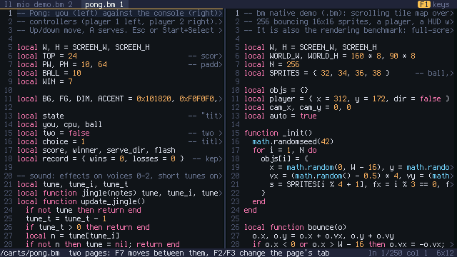
  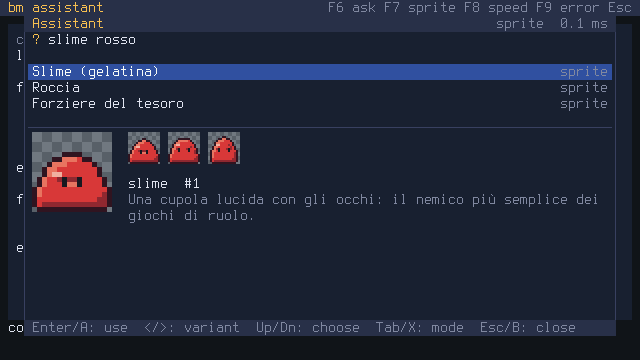<br>
  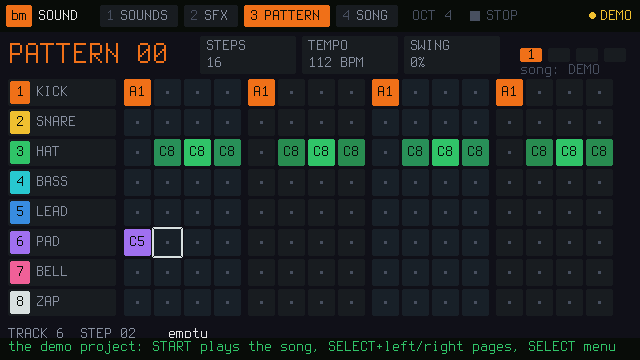
  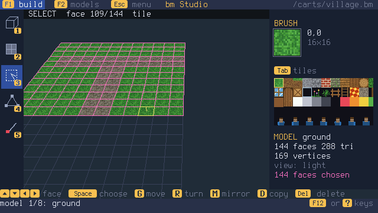<br>
  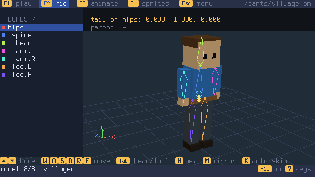
  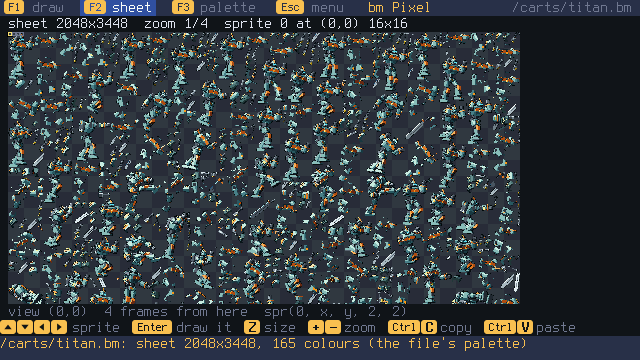
</p>

---

## 🎮 Featured Games

<p align="center">
  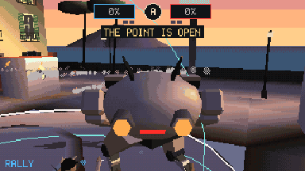
  <br><sub><b>Overbit</b>: 3D first-person hero shooter at 480×270 / 60 fps with 10-player AI bot battles, 8 heroes, and local/LAN netplay. <a href="docs/img/overbit-match.mp4">Watch MP4</a></sub>
</p>

<p align="center">
  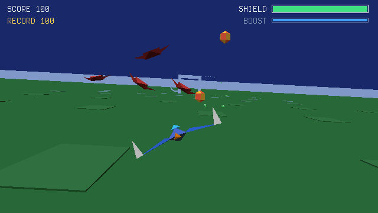
  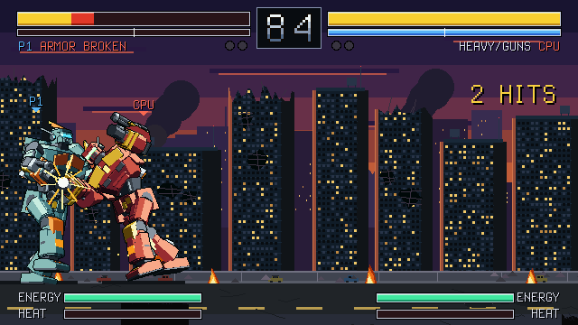
  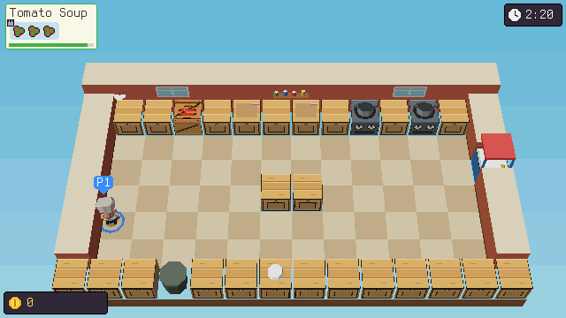
  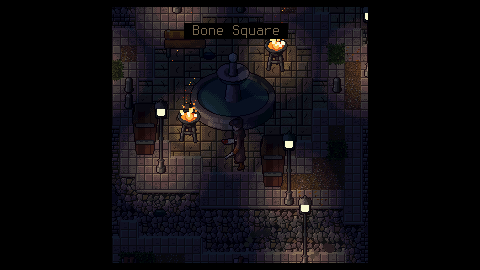
</p>

- **Overbit**: 3D hero shooter with 8 heroes (Rally, Kaiju, Sarge, Frost, Fuse, Rail, Orbit, Akari), a control point mode, AI bots, baked lighting on the Partenope map, and lockstep netplay.
- **Astro Wing**: a polygon space fighter in the style of the SNES classics.
- **Titan Clash**: a fighting game of giant robots, 1 or 2 players.
- **Chaos Kitchen**: a cooperative cooking game for 1 to 4 players on one screen.
- **Yharnam**: an endless gothic town at night, seen from above, at 360×360 (`.b16`).
- **Also in the repository**: Pong, Snake, Star Shooter, KO-II (a keyboard groovebox), `nano8` (PICO-8 carts), Pad Typing, bm Write, bm Web (a web browser for HTML5, CSS and JavaScript pages, https only), Hero Stress and the 3D Bench. The covers are drawn by `scripts/mkartcovers.py`.
- **bm Market**: an online catalog with a Games page and an Apps page (the editors, bm Write, Pad Typing, the 3D Bench). It downloads free cartridges to the SD card and checks each file with its SHA-256 ([`market/README.md`](market/README.md)).

---

## 📦 Quick Start

### Build Prerequisites
Requires `arm-none-eabi-gcc`, Python 3, `dosfstools`, `mtools`, and QEMU (for emulation tests). This is the package list of the CI ([`.github/workflows/ci.yml`](.github/workflows/ci.yml)). The RGB30 kernel needs `aarch64-linux-gnu-gcc` and picolibc ([`docs/RGB30.md`](docs/RGB30.md)).

```bash
# Ubuntu / Debian
sudo apt-get install -y gcc-arm-none-eabi libnewlib-arm-none-eabi binutils-arm-none-eabi \
  qemu-system-arm make python3 python3-numpy python3-pil dosfstools mtools
```

### Build & Run
```bash
# 1. Fetch the Pi firmware once, then build the bootable disk image (dist/bm.img)
make firmware && make image

# 2. Run the host tests and the QEMU regression tests (all of them)
make test

# 3. Launch the Pi kernel in QEMU
make qemu
```

`make` builds the kernel and the game cartridges. Run only the tests a change affects, for example `python3 tests/qemu_test.py --build build -k <name>` or `make test-b3d`. A cartridge is built by one rule in the Makefile: add a `carts/<id>/` folder and its name to `GAMES` ([`docs/PROJECT-LAYOUT.md`](docs/PROJECT-LAYOUT.md)). Change a game or app in its `.bme` project, then build the `.bm` from it.

### Flashing to Hardware
1. Flash `dist/bm.img` to a microSD card using [Raspberry Pi Imager](https://www.raspberrypi.com/software/) (*"Use Custom"*), balenaEtcher, or `dd`. From WSL, `./easy_install.sh` also updates the kernel on a card or over the network.
2. Connect HDMI to a display and plug in a USB keyboard or gamepad via OTG adapter.
3. Insert the card into your Raspberry Pi Zero W and power on.

---

## 📚 Documentation & Architecture

- **Living Progress & Index**: [`docs/progress.md`](docs/progress.md) *(the canonical navigation root)*.
- **Lua API Reference**: [`docs/API.md`](docs/API.md) *(complete draw, input, audio, 3D, and netplay reference)*.
- **Game Authoring Guide**: [`docs/GAME-GUIDE.md`](docs/GAME-GUIDE.md) (Italian: [`docs/GUIDA-GIOCHI.md`](docs/GUIDA-GIOCHI.md)).
- **Architecture & Design RFCs**: [`docs/design/`](docs/design/).
- **Performance & Drivers**: [`docs/PERF-BUDGET.md`](docs/PERF-BUDGET.md) *(what a frame holds)*, [`docs/BENCH3D.md`](docs/BENCH3D.md), [`docs/PERFORMANCE.md`](docs/PERFORMANCE.md), [`docs/DRIVERS.md`](docs/DRIVERS.md), and [`docs/HARDWARE.md`](docs/HARDWARE.md).
- **Next tasks**: [`docs/NEXT.md`](docs/NEXT.md) and the plan in [`docs/ROADMAP.md`](docs/ROADMAP.md).
- **OS Capabilities**: [`docs/OS-CAPABILITIES.md`](docs/OS-CAPABILITIES.md) *(what bm can and cannot do, compared with Linux and Windows)*.
- **AI Agent Guidelines**: [`CLAUDE.md`](CLAUDE.md) and [`GEMINI.md`](GEMINI.md).

---

## ⚖️ License

bm is developed by **F. Accomando** and licensed under the **BM Community License 1.0** ([`LICENSE`](LICENSE)).

- Individuals may freely use, modify, and redistribute the project, including commercial projects on their own behalf.
- Attribution is required; modified versions must remain under the same license.
- Organizations require a separate commercial license.
- Embedded third-party components retain their respective open-source licenses: Lua (MIT), lwIP (BSD), mbedTLS (Apache 2.0).
