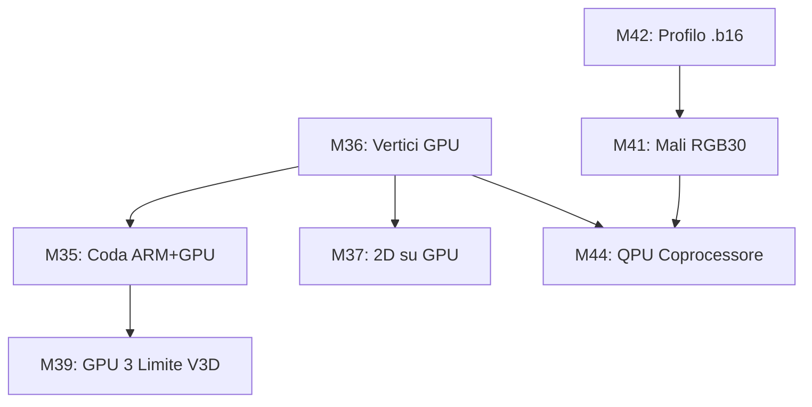

# Roadmap bm

Le milestone chiuse e il testo storico sono nella storia git (commit `0e969b5`).

**bm**, BareMetal: una *fantasy console* bare metal per Raspberry Pi Zero W (e PowKiddy
RGB30) che avvia da SD, mostra un menu, carica giochi in Lua (cartucce `.bm`, intestazione
`BMCART`, cartella `bm/` sulla SD) e li esegue a 60 fps con grafica, input e audio. Strumenti
`tools/bm_net.py`, `tools/bm_load.py`, `scripts/mkbm.py`, runtime in `src/bm/`.

Ogni milestone ha un **criterio di completamento** verificabile ("Fatto quando") e, quando
possibile, un test automatico sul PC o in QEMU (`-M raspi0`). Dimensione: **S** = pochi
giorni, **M** = 1–2 settimane, **L** = più di 2 settimane (XL: più di una L).

> [!NOTE]
> I dettagli operativi di basso livello, le checklist di debug, i registri hardware e le note di implementazione specifiche sono tracciati nei rispettivi documenti in [`docs/progress/`](progress/).

---

## Indice delle Aree di Sviluppo in `docs/progress/`

- **Grafica & GPU Pi Zero (V3D & QPU)**: [`progress/v3d.md`](progress/v3d.md) e [`progress/graphics.md`](progress/graphics.md)
- **Mali GPU & RGB30 Hardware**: [`progress/graphics-mali.md`](progress/graphics-mali.md) e [`progress/platforms.md`](progress/platforms.md)
- **Profilo .b16 Standard**: [`progress/b16.md`](progress/b16.md)
- **Architettura Giochi & Gameplay Kit**: [`progress/games-architecture.md`](progress/games-architecture.md)
- **Yharnam (Verifiche, Mappa & Prestazioni)**: [`progress/yharnam.md`](progress/yharnam.md)
- **Strumenti & Suite Console**:
  - Panoramica Tools & Market: [`progress/tools.md`](progress/tools.md)
  - bm Pixel (Sprite & Stack): [`progress/suite-pixel.md`](progress/suite-pixel.md)
  - bm SDK (Hub & Level Design): [`progress/suite-sdk.md`](progress/suite-sdk.md)
  - bm Code (IDE & Moduli): [`progress/suite-code.md`](progress/suite-code.md)
  - bm Animator (Rig & Bake 2D): [`progress/suite-animator.md`](progress/suite-animator.md)
  - bm Studio & Mesh (Modelli 3D): [`progress/suite-studio-mesh.md`](progress/suite-studio-mesh.md)
  - bm Sound & Audio Engine: [`progress/audio.md`](progress/audio.md) e [`progress/suite-sound.md`](progress/suite-sound.md)
- **Sistema, Kernel & Hardware**: [`progress/system.md`](progress/system.md) e [`progress/runtime.md`](progress/runtime.md)

---

## Dipendenze tra le Milestone Aperte

- M35 (coda) e M37 (2D nel lavoro della GPU) si misurano insieme con il vertex shader di M36.
- M39 parte dalle misure sul Pi dei profili di M35–M36.
- M44 usa l'interprete QPU dell'emulatore di M36; sulla RGB30 aspetta il driver Mali di M41.
- M42, passo 5 → Overbit in `.b16` (M41, passo 1).
- M43, M45, M46, M47, M48: indipendenti.

---

## Decisioni di Base in Vigore

- **Video delle cartucce `.bm` (2026-09-26)**: 640×360 standard 16:9 (scala intera ×2 su 720p e ×3 su 1080p); 320×180 facoltativa; 360×360 su `.b16`. Formato colore RGB565. Budget disegno sotto il 25% del frame; rendering in C, Lua solo logica.
- **Opzioni GPU e 3D (2026-10-03)**: Ogni novità GPU che modifica aspetto o latenza è un'opzione configurabile in `bm/config.txt` o via `gpu3d()`. Misurazioni comparative su Overbit (benchmark bot, anello eroi). Overlay unico FPS / ms / CPU / GPU su F11.

---

## Milestone di Sviluppo

### M35 — ARM e GPU insieme (M) — sul PC, da provare sul Pi
- **Obiettivo**: Spostare l'attesa ARM della V3D fuori dal frame tramite code asincrone (`gpu3d_queue`, 2D dopo il 3D, `gpu3d_wc`).
- **Dettagli tecnici**: [`progress/v3d.md`](progress/v3d.md)
- **Fatto quando**: I benchmark di Overbit e lo stress test sul Pi mostrano un chiaro guadagno sia con opzione attiva che spenta.

### M36 — Vertici sulla GPU (L/XL) — quasi completa sul Pi
- **Obiettivo**: La mesh viene caricata sulla GPU una sola volta; ad ogni `draw3d` l'ARM invia matrici e luci, mentre le QPU trasformano e illuminano (`vs_lit`, `vs_tex`, ombre).
- **Dettagli tecnici**: [`progress/v3d.md`](progress/v3d.md)
- **Fatto quando**: L'anello di eroi di Overbit e lo stress test raddoppiano le prestazioni a 60 fps rispetto all'elaborazione solo ARM.

### M37 — 2D e qualità sulla GPU (M) — fatta su PC, da provare sul Pi
- **Obiettivo**: Rendering 2D integrato nel flusso GPU (`gpu3d_2d`), `menu_scale=3` a 1080p nativi, filtri bilineari opzionali.
- **Dettagli tecnici**: [`progress/v3d.md`](progress/v3d.md)
- **Fatto quando**: Il passo 16 del test `g` sul Pi mostra pixel identici tra ARM e GPU e il menu a 1080p si visualizza correttamente ingrandito.

### M39 — GPU 3: verso il limite della V3D (L/XL) — passi bm3d 5.0–6.9 su PC
- **Obiettivo**: Portare il throughput dei triangoli oltre i 6–8 milioni al secondo tramite attributi compatti (8 bit), texture 16 bit (`gpu3d_tex16`) ed ETC1 compresso (`gpu3d_etc1`).
- **Dettagli tecnici**: [`progress/v3d.md`](progress/v3d.md)
- **Fatto quando**: Lo stress test regge il doppio dei triangoli a 60 fps e Overbit gestisce 10 bot a 60 fps stabili in qualità HIGH.

### M41 — RGB30: la GPU Mali e Overbit in `.b16` (XL) — in corso (driver)
- **Obiettivo**: Abilitare l'accelerazione 3D hardware della GPU Mali-G52 (Bifrost) sulla console PowKiddy RGB30 a risoluzioni 360×360 e 720×720 nativi.
- **Dettagli tecnici**: [`progress/graphics-mali.md`](progress/graphics-mali.md) e [`progress/platforms.md`](progress/platforms.md)
- **Fatto quando**: Overbit `.b16` gira a 60 fps sulla RGB30 con accelerazione Mali e la tabella 3D Bench riporta le metriche GPU.

### M42 — Il profilo `.b16` (L) — in corso
- **Obiettivo**: Ambiente standardizzato a risorse vincolate (schermo 360×360, 256 colori, 4 MiB Lua, 8 MiB max, obiettivo 60 fps, nessun throttle automatico), identico tra Pi e RGB30.
- **Dettagli tecnici**: [`progress/b16.md`](progress/b16.md)
- **Fatto quando**: *Yharnam* `.b16` gira in modo perfettamente indistinguibile su Pi Zero W e RGB30, con medesimo comportamento di throttle CPU.

### M43 — Sprite Stacking (L) — in specifica
- **Obiettivo**: Supporto nativo per volumi pseudo-3D composti da fette 2D sovrapposte (`stack`, `zstack`, `stackv`), con editor dedicato in bm Pixel e conversione automatica in mesh e fotogrammi.
- **Dettagli tecnici**: [`progress/suite-pixel.md`](progress/suite-pixel.md)
- **Fatto quando**: Decine di pile rotanti girano a 60 fps su Pi, disegnabili in bm Pixel e convertibili in modelli 3D per bm Studio/Animator.

### M44 — La GPU come coprocessore: programmi sulle QPU (L/XL) — da fare
- **Obiettivo**: Esecuzione di calcoli generici non grafici sulle 12 QPU SIMD (particelle su larga scala, illuminazione a livelli di Yharnam, filtri audio a blocchi, raycasting).
- **Dettagli tecnici**: [`progress/v3d.md`](progress/v3d.md)
- **Fatto quando**: Particelle e buio di Yharnam sono calcolati dalla GPU alleggerendo la CPU ARM, con fallback trasparente in assenza di GPU.

### M45 — bm Write: editor di documenti (M) — in corso
- **Obiettivo**: Applicazione di produttività per la console per la stesura e impaginazione A4 di testi in formato `.BMD` con esportazione in `.TXT`, `.MD`, `.HTM` e `.PDF`.
- **Dettagli tecnici**: [`progress/tools.md`](progress/tools.md)
- **Fatto quando**: Sul Pi è possibile comporre un documento formattato con titoli e stili, esportarlo in PDF e visualizzarlo identico su PC.

### M46 — Audio 2: suono Hi-Fi, strumenti e assistente (L) — in corso
- **Obiettivo**: Sintetizzatore stereo 24-bit con riverbero/echo, supporto campioni PCM/WAV, assistente musicale su F6 ed estensione del linguaggio `riff`.
- **Dettagli tecnici**: [`progress/audio.md`](progress/audio.md) e [`progress/suite-sound.md`](progress/suite-sound.md)
- **Fatto quando**: I giochi e i brani composti in bm Sound suonano con fedeltà a 24 bit su Pi e RGB30, con supporto per campioni PCM e pattern riff.

### M47 — Progetti e giochi: `.bme` modificabili, `.bm` in sola lettura (M) — in corso
- **Obiettivo**: Separazione netta tra progetti in lavorazione (`.bme`, editabili dagli strumenti della console) e cartucce pubblicate (`.bm`, in sola lettura).
- **Dettagli tecnici**: [`progress/tools.md`](progress/tools.md)
- **Fatto quando**: Gli strumenti aprono i `.bm` in sola lettura chiedendo la creazione di una copia `.bme`, e la compilazione (`Ctrl+B`) genera il `.bm` definitivo in Games.

### M48 — Il mouse nella bm Suite (M) — in corso
- **Obiettivo**: Supporto completo del puntatore del mouse (USB e Bluetooth) in tutti gli editor della suite, mantenendo la perfetta parità funzionale coi tasti.
- **Dettagli tecnici**: [`progress/tools.md`](progress/tools.md)
- **Fatto quando**: Ogni programma della suite consente di selezionare, disegnare e navigare tramite puntatore mouse senza ausilio obbligatorio della tastiera.

---

## Indice degli Spunti di Miglioramento (R1, R2, ...)

Gli spunti tecnici per future evoluzioni sono stati trasferiti e categorizzati nelle rispettive schede di dettaglio in `docs/progress/`:

| Categoria | Identificativo Spunti | Documento di Tracciamento |
|---|---|---|
| **Console Standalone & Sistema** | R1 (WiFi pad), R2 (Tastiera C), R3 (Log SD), R4 (Screenshot), R6 (Web UI), R8 (Rumble DS4), R19 (Pad BT), R20 (HDMI-CEC) | [`progress/system.md`](progress/system.md) |
| **API Runtime & Giochi** | R7 (Accenti UTF-8), R27 (Batteria & Autosave), bmnet (Multiplayer) | [`progress/runtime.md`](progress/runtime.md) |
| **Grafica, QPU & Impostor** | R40 (Stat profiler), R41 (Scaling sinc/QPU), R42 (Impostor eroi) | [`progress/v3d.md`](progress/v3d.md) |
| **Audio Engine & Campioni** | R9 (WAV SD), R17 (Import MIDI), R21 (Audio GPIO), R25 (Audio PC), R31-R35 (Campioni & Riff) | [`progress/suite-sound.md`](progress/suite-sound.md) e [`progress/audio-output.md`](progress/audio-output.md) |
| **Level Design & SDK** | R11 (Import Tiled), R37 (Palette mappe), R38 (Assistente 16×16), R39 (SDK 720×720) | [`progress/suite-sdk.md`](progress/suite-sdk.md) |
| **IDE & Tooling** | R15 (Live reload PC), R16 (Template bm Code), R26 (Mouse nano8) | [`progress/tools.md`](progress/tools.md) e [`progress/suite-code.md`](progress/suite-code.md) |
| **Hardware & Piattaforme** | R22 (Handheld Pi Zero su GPIO) | [`progress/platforms.md`](progress/platforms.md) |

---

## Rischi Principali di Progetto

- **Prestazioni del Lua su ARM1176**: disegno demandato interamente al C, cache attive, parti computazionali critiche spostate nel runtime C o su QPU.
- **Firmware closed-source Broadcom**: versione bloccata con riferimento `FW_REF` per evitare regressioni video o mailbox.
- **Integrità scheda SD**: verifiche preliminari di hash dei file scaricati, allocazione protetta delle catene FAT e isolamento delle cartelle di sistema.
- **Driver GPU senza hardware in CI**: test continui con emulatori QPU/V3D software su PC, timeout di protezione e rasterizzatore software come fallback di emergenza.

---

## Hardware Consigliato per lo Sviluppo

- **Debug Seriale**: Adattatore USB-seriale a **3.3 V** (non 5 V) connesso a GPIO14/15 + GND.
- **Alimentazione**: Alimentatore 5 V 2 A stabile per evitare sbalzi di tensione sotto carico GPU.
- **Controller & Input**: DualShock 4 (controller Bluetooth di riferimento) e mouse USB/Bluetooth (M48).
- **Audio Analogico**: Filtro RC passivo (270 Ω + 33 nF) con jack stereo su pin GPIO (R21).
