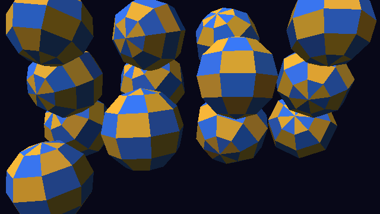

# Rendering stress test — bm on Raspberry Pi Zero W

Goal: find out **how many objects per frame** bm can draw before dropping below
**60 fps** (16.7 ms per frame) and below **30 fps** (33.3 ms per frame), for sprites and
for 2D/3D polygons, both from C and through the cartridge Lua API (`.bm`).

> **Status:** measured on the real Pi Zero W (kernel `792787f`, 2026-09-26). QEMU
> values are reported only as a check: QEMU does not emulate caches, the memory bus or
> real timing.

## Method

- Video mode of native cartridges: **640×360, RGB565, double buffer**.
- For each test the load starts from an initial value and grows by 50% at each step
  (1, 2, 3, 4, 6, 9, 13, … or 16, 24, 36, …).
- At each step **20 frames** are drawn and **only the draw time** is measured
  (for the Lua part: `_update` + `_draw`), without waiting for the 60 Hz pacing.
- It stops when a step exceeds 40 ms. The 16.7 ms and 33.3 ms thresholds are obtained by
  **linear interpolation** between the two straddling steps (the cost grows roughly
  linearly with the number of objects).
- "us/item" is the slope: the cost of one more object, in microseconds.
- Every frame starts with `cls` (full screen), so the fixed clearing cost is included.
- The details of each step go out on the serial port; the screen shows the final table.

## Tests

| Test | What it draws | Notes |
|---|---|---|
| sprites 16×16 (C) | N 16×16 sprites with transparency, half mirrored, moving | C blit with mask |
| sprites 32×32 (C) | as above, 32×32 | 4× the pixels per sprite |
| triangles 2D ~170px | N filled triangles about 20 px per side (≈170 pixels each) | scanline rasterizer |
| 3D spheres 96 (C) | N spheres of 96 triangles (6×8), rotating, perspective, z-buffer, per-face light | about 40% of the triangles are visible (the others are discarded as back faces) |
| 3D smooth (Gouraud) | the same spheres with `R3D_SMOOTH`: per-vertex light, blended color and dithering | from the Gouraud kernel (M14), to be measured on the Pi |
| 3D textured | the same spheres with a 16×32 checkerboard texture from the sheet (perspective-correct) | from the Gouraud kernel (M14), to be measured on the Pi |
| sprites 16×16 (Lua) | like the C test, but each sprite is a `spr()` call from Lua with the position computed in Lua | real cost for a cartridge |
| 3D spheres 96 (Lua) | like the C test, with `draw3d()` called from Lua | transforms and raster in C |
| quad 320×180 flat / no z / Gouraud / texture | N quads of 320×180 pixels (a quarter of the screen, i.e. one whole 320×180 screen), one per quadrant in turn, each closer than the previous: every pixel passes the z-buffer and is written | the slope is the **cost of one pixel** (`ns/px` column), without the per-triangle work of the spheres; 256×256 texture, larger than the data cache (M33) |
| GPU spheres 96 / smooth / textured, GPU quad flat / Gouraud / texture | the same scenes with the 3D drawn by the GPU (`gpu3d` backend, M33): the ARM transforms, lights and clips, the V3D fills the pixels; the time includes the GPU work | Pi only (in QEMU the `GPU rows: none (...)` line says why they are missing); GPU quads go up to 2000, each closer than the previous by one 24-bit z step |
| GPU spheres AA 4x, GPU quad AA 4x | GPU spheres and flat quads with 4× MSAA anti-aliasing (M34): 32×32 pixel tiles with 4 samples each | the cost of MSAA relative to the GPU rows without it; `no MSAA on this GPU` if the startup probe does not find it |
| GPU+VS spheres 96, GPU+VS smooth | the spheres of the GPU rows with vertices placed by the GPU vertex shader (M36): the ARM sends only matrices and lights | how many more spheres compared to the GPU rows (M36 goal: at least double at 60 fps); `no vertex shader for lit models on this GPU` if the startup probes do not find it |

For 3D the table reports the number of spheres and, in parentheses, the **triangles
actually drawn** per frame.

## 3D Pipeline (software)

The 3D is drawn by the GPU (V3D, M33: `src/gpu/gpu3d.c`) after the ARM has transformed,
lit and clipped; the software rasterizer on the ARM (`src/bm/r3d.c`, described
below) remains with `gpu3d=0`, in QEMU, if the GPU does not respond and for what the GPU
cannot do yet (shadows, 3D effects, dithering, textures with precomputed light).
- per-vertex floating-point transform (VFP), camera with yaw/pitch and FOV;
- back-face culling and culling of objects behind the camera (no
  near-plane clipping: a triangle crossing it is discarded);
- filled scanline triangles with a **16-bit z-buffer** (1/z), flat shading
  (per-face Lambert + ambient light);
- since 2026-09-27 textures (perspective-correct) and near-plane clipping; since
  2026-09-29 Gouraud (`R3D_SMOOTH` flag, per-vertex light, 4×4 dithering). The measurements
  below are for the flat rasterizer.

Cartridge API: `mesh`, `mesh_sphere`, `mesh_cube`, `draw3d`, `camera3d`,
`light3d`, `zclear`, `tri` (see README).



## Results

**Kernel version:** the tag at the top left of the screen (light blue bar,
e.g. `bm 1b31924`) is the git commit the kernel was built from. The stress
test exists since version `1b31924`: with a different tag (e.g. `7044581`, which is M5)
the SD holds an older kernel. If `-dirty` appears, the kernel was built
with uncommitted local changes.

| Measurement | Version | Date |
|---|---|---|
| Pi Zero W v1.1, 1 GHz, caches on | `792787f` | 2026-09-26 |
| QEMU (check) | `1b31924` | 2026-09-26 |
| Pi Zero W, repeated (direct drawing) | `89452b3` | 2026-09-27 |

> The stress test also counts the copy to the screen, if any, when cartridges
> draw via RAM (`V` command, not the default). The numbers below were
> measured drawing directly into video memory, as the default does; repeated
> with `89452b3` they give the same values (4481 16×16 sprites, 1207 3D triangles at 60 fps).
> The `p` benchmark on the same kernel: full map + 256 sprites 8.50 ms direct,
> 12.65 ms via RAM.

Maximum number of objects per frame (640×360, RGB565):

| Test | **Pi 60 fps** | **Pi 30 fps** | **Pi µs/object** | QEMU 60 fps | QEMU 30 fps |
|---|---:|---:|---:|---:|---:|
| sprites 16×16 (C) | **4482** | **9255** | 3.49 | 2133 | 4088 |
| sprites 32×32 (C) | **1513** | **3130** | 10.30 | 635 | 1363 |
| triangles 2D ~170px | **2594** | **5368** | 6.00 | 1340 | 2680 |
| 3D spheres 96 (C) | **31** (1195 tri) | **129** (5011 tri) | 162.88 | 16 (602 tri) | 53 (2065 tri) |
| sprites 16×16 (Lua) | **1829** | **3774** | 8.52 | 994 | 1822 |
| 3D spheres 96 (Lua) | **29** (1115 tri) | **120** (4692 tri) | 169.97 | 16 (603 tri) | 48 (1868 tri) |

Repeatability: a second run on the same Pi gave the same values within
±1 object (e.g. 4481 vs 4482 sprites, 5010 vs 5011 triangles), so the measurement
is stable.

### What the Pi numbers say

- **Sprites in C:** ~4500 16×16 sprites at 60 fps. The cost is almost all in the pixels:
  3.5 µs for 256 pixels (~14 ns/pixel); the 32×32 has 4× the pixels and costs 3× (10.3 µs),
  so per-sprite handling weighs little and the limit is the bandwidth to video
  memory.
- **Sprites from Lua:** ~1800 at 60 fps. The difference from C (8.5 − 3.5 ≈ **5 µs per
  sprite**) is the Lua logic of the test (position computation) plus the `spr()` call.
  For a game: hundreds of sprites with real logic stay comfortably at 60 fps.
- **2D triangles** (~170 px): ~2600 at 60 fps, 6 µs each (~35 ns/pixel including
  scanline setup).
- **3D:** ~**1200 triangles drawn** at 60 fps, ~5000 at 30 fps (about 14 µs per
  drawn triangle, including transforms, discarded faces, screen and
  z-buffer clearing). From Lua the cost is almost identical (+4%), because all the 3D work is in C.
  It is a late-90s console budget in software: low-poly scenes at 60 fps,
  richer scenes at 30 fps.
- **Comparison with the declared `.bm` budget** (full map + 256 sprites under
  25% of the frame): 256 16×16 sprites cost ~0.9 ms, well within.

Reference data already measured on the real Pi (M3–M7): 640×360 32-bit fill
2.2 ms; C demo with 64 sprites 2.7 ms per frame; Lua about 100 ns per simple operation.

### Measurement of 2026-09-29 (`8298b15`)

Table and analysis in `docs/ROADMAP.md` (M14): C part slower than in September, Lua part
the same; since then the stress test prints clock, temperature, throttling and a
CPU-only loop before and after the C part, to understand the difference at the next measurement.

### Measurement of 2026-10-01 (`6c2fdaa`, M33)

With the system idle (the C part waits 20 s after boot): ARM 1000 MHz, core 250 (maximum
400), V3D 250, SDRAM 400 MHz, 49.7 °C, no throttling, interrupts 0.4% (1188/s).

| Test | Pi 60 fps | Pi 30 fps | µs/object |
|---|---:|---:|---:|
| sprites 16×16 (C) | 4456 | 9204 | 3.50 |
| sprites 32×32 (C) | 1504 | 3113 | 10.36 |
| triangles 2D ~170px | **5038** | 10424 | 3.09 |
| 3D spheres 96 (C) | **70** (2700 tri) | 226 (8914 tri) | 114.11 |
| 3D smooth (Gouraud) | 18 (705 tri) | 84 (3276 tri) | 221.84 |
| 3D textured | <1 | 51 (1987 tri) | 238.64 |
| quad 320×180 flat | 11 | 24 | 22 ns/px |
| quad 320×180 no z | 53 | 114 | 5 ns/px |
| quad 320×180 Gouraud | 5 | 11 | 49 ns/px |
| quad 320×180 texture | 2 | 5 | 97 ns/px |
| sprites 16×16 (Lua) | 1848 | 3817 | 8.42 |
| 3D spheres 96 (Lua) | 61 (2323 tri) | 204 (7994 tri) | 126.70 |

The sprites return to the September values, so the 29 September drop was a
startup disturbance. The M33 rasterizer (fixed-point edges, specialized texture
loops) brings 2D triangles to 1.9× and 3D spheres to 2.3× compared to
September. The GPU rows are missing (`GPU rows: none (probe: a clear did not finish)`):
it was an error in the driver wait, fixed after this measurement (see
`docs/GPU-BENCHMARK-REPORT.md`).

With `d0c7fe8` (same day, driver fixed) the ARM rows repeat the same values
within one object, and the GPU rows appear:

| Test | Pi 60 fps | Pi 30 fps | µs/object |
|---|---:|---:|---:|
| GPU spheres 96 | **182** (7142 tri) | 389 (15346 tri) | 80.10 |
| GPU smooth (Gouraud) | **170** (6673 tri) | 364 (14360 tri) | 85.58 |
| GPU textured | **156** (6094 tri) | 333 (13135 tri) | 93.16 |
| GPU quad flat | **200** | 430 | 1 ns/px |
| GPU quad Gouraud | **199** | 427 | 1 ns/px |
| GPU quad texture | **28** | 60 | 9 ns/px |

With the GPU the spheres are limited by the ARM (transforms and vertices, ~2 µs per
triangle), the quads by the V3D: 1 ns per pixel solid or Gouraud, 9 with the
256×256 texture in row order.

After M33 (M34, to be measured on the Pi): the page cleared with `cls` is not re-read by the
GPU, textures with sides that are multiples of 32 go into T-format (the 256×256 quad texture
benefits: to be compared with the 9 ns/px above) and two new rows measure
4× MSAA.

### Measurement of 2026-10-05 (kernel v0.2.0, bm3d 4.2)

`stress` report in the `reports` branch. ARM 1000 MHz, core 250 (maximum 400), V3D 250, SDRAM
400 MHz, 47.6 → 52.9 °C, no throttling, interrupts 0.5% (1188/s). The 3D rows: ARM as
bm3d 0.2, GPU as 2.1; the GPU+VS rows are missing because the vertex shader probe at startup
did not pass (`vertex shader no`, `docs/ROADMAP.md`, M36).

| Test | Pi 60 fps | Pi 30 fps | µs/object |
|---|---:|---:|---:|
| sprites 16×16 (C) | 4454 | 9200 | 3.51 |
| sprites 32×32 (C) | 1501 | 3108 | 10.37 |
| triangles 2D ~170px | 4726 | 9777 | 3.29 |
| 3D spheres 96 (C) | 63 (2451 tri) | 201 (7910 tri) | 128.01 |
| 3D smooth (Gouraud) | 25 (990 tri) | 99 (3846 tri) | 212.54 |
| 3D textured | <1 | 50 (1910 tri) | 259.37 |
| quad 320×180 flat | 11 | 25 | 22 ns/px |
| quad 320×180 no z | 52 | 113 | 5 ns/px |
| quad 320×180 Gouraud | 6 | 13 | 41 ns/px |
| quad 320×180 texture | 3 | 6 | 81 ns/px |
| GPU spheres 96 | **207** (8131 tri) | 433 (17115 tri) | 73.02 |
| GPU smooth (Gouraud) | 159 (6224 tri) | 334 (13178 tri) | 94.38 |
| GPU textured | 165 (6465 tri) | 347 (13675 tri) | 90.64 |
| GPU quad flat | 203 | 428 | 1 ns/px |
| GPU quad Gouraud | 199 | 419 | 1 ns/px |
| GPU quad texture | **91** | 193 | **3 ns/px** |
| GPU spheres AA 4x | 204 (8043 tri) | 429 (16963 tri) | 73.53 |
| GPU quad AA 4x | 199 | 420 | 1 ns/px |
| sprites 16×16 (Lua) | 1990 | 4110 | 7.85 |
| 3D spheres 96 (Lua) | 193 (7559 tri) | 393 (15499 tri) | 82.41 |

With the GPU the spheres go from 182 to 207 (73 µs per sphere instead of 80: less ARM work
per triangle, M34) and the 256×256 quad texture from 9 to 3 ns per pixel (the tiles); MSAA
costs almost nothing. Lua spheres now run on the GPU (193). On the ARM, compared to
1 October, flat spheres drop (70 → 63) and Gouraud rises (18 → 25).

## How to run it on the Pi

```sh
cd ~/bm && git pull
make sdcard-stress               # kernel dedicato: esegue lo stress test all'avvio
sudo umount /mnt/d 2>/dev/null; sudo mount -t drvfs D: /mnt/d
cp dist/kernel.img /mnt/d/ && sync && cmp dist/kernel.img /mnt/d/kernel.img && echo "COPIA OK"
sudo umount /mnt/d
```

At startup, after the system summary, the six tests scroll by (about 30–60 s in total)
and at the end the results table stays on the screen: a photo is enough.
To return to the normal kernel: `make sdcard` and copy `dist/kernel.img` again.
With the serial cable the same test starts from the monitor with the `S` key.

For the per-device game budget (loads for 60 and 30 fps, Pi and RGB30) see the section *Game budget* in [`PERFORMANCE.md`](PERFORMANCE.md).

## The machine rows (M33)

Before and after the C part the stress test writes two lines:

- `ARM ... MHz, core ... (max ...), V3D ..., SDRAM ... MHz, ... C`: the clocks. The **core**
  drives the L2 cache and the memory bus; `enable_uart=1` in `config.txt` pins it to
  250 MHz (with `force_turbo=1` the firmware instead pins it to the turbo frequency, 400 MHz
  on the Zero: to be tried, comparing the `quad` rows).
- `throttled ..., loop ... ms, irq ...% (N/s; ... )`: the firmware throttling flags
  (0 = none), the time of a CPU-only loop and the share of time spent in
  interrupts (audio, Bluetooth, timers...), with the two heaviest: it is the time that
  drawing does not have.

The `make sdcard-stress` kernel waits until the kernel has been running for 20 s before starting: right
after boot the WiFi connects and the paired pad reconnects, and the first tests
paid for it (with `8298b15` the 3D sphere from Lua ran almost twice as fast as the one in C).

## How to read the results

- **C vs Lua:** the difference between the two "sprites 16×16" rows is the cost of the
  Lua logic per sprite (position computation + `spr` call): it is what a cartridge pays.
- **32×32 vs 16×16:** if the cost per sprite grows roughly 4×, the limit is the number
  of pixels (bandwidth to video memory), not sprite handling.
- **3D:** the limit is the number of triangles drawn and their area. The spheres in the
  test are small (at most a few hundred pixels per triangle); large triangles
  cost more.
- **Quad:** `ns/px` is the cost of one pixel written for each mode; for example with
  100 ns/px textures fill about 167,000 pixels in 16.7 ms (minus the rest of the
  frame).

## Possible optimizations (after the measurements)

- 32-bit sprite writes (2 pixels at a time) and dedicated paths for flips;
- fixed-point rasterizer with per-scanline increments instead of divisions;
- redrawing only the changed areas (dirty rectangles) for fixed-screen games;
- Gouraud and textures only if the budget allows;
- long term: the VideoCore IV 3D GPU (V3D) without an operating system,
  a separate project.
