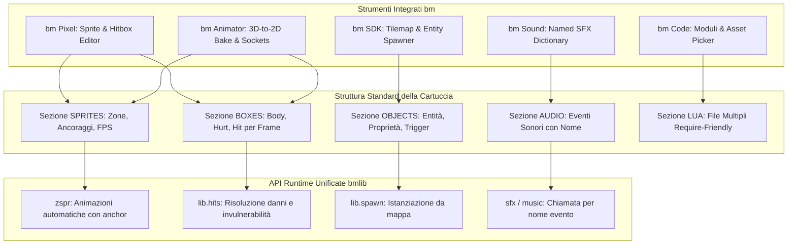

# Analisi dell'Architettura dei Giochi bm e Limiti dello Sviluppo Nativo

Questo documento analizza l'architettura tecnica dei giochi finora sviluppati per la console **bm**, estrae i pattern strutturali ricorrenti e valuta la fattibilità dello sviluppo operando **esclusivamente con gli editor integrati della console** (`bm SDK`, `bm Pixel`, `bm Code`, `bm Animator`, `bm Studio`, `bm Mesh`, `bm Sound`).

Infine, propone una **struttura unificata standard** per semplificare la produzione di giochi complessi, rimandando a documenti di dettaglio per ciascuna suite in `/docs/progress/`.

---

## 1. Analisi dei Giochi Finora Prodotti

Nel catalogo di cartucce (`carts/` e `video/`) emergono diversi archetipi tecnologici e strutturali:

| Gioco / Progetto | Genere | Risoluzione & Stile | Architettura Codice | Pipeline Grafica & Animazioni |
|---|---|---|---|---|
| **Titan Clash** (`carts/titan`) | Picchiaduro Versus 2D | 640×360 (e 360×360 su `.b16`) | Multi-file modulare (11 file Lua concatenati via `build.py`) | Pre-rendering 3D ortografico con solidi e scheletro (`mkrobot.py`), calcolo automatico hitbox/hurtbox da ossa |
| **Yharnam** (`carts/yharnam`) | Action RPG Gotico 3/4 | 360×360 (pannello RGB30) | Monolite procedurale (5573 righe in `main.lua`) | Pre-rendering 3D procedurale SDF (`mkassets.py`), oltre 5000 frame su 8 direzioni, curve Hermite, streaming mappe CSV a chunk |
| **Skyvale World** (`video/`) | Platformer 2D 16-bit | 640×360 | Sequenziale da tutorial (`lib.tiles`, `lib.step`) | Pixel art manuale in bm Pixel (`skyvale.bm`), tessere e mappe multi-layer nell'SDK, flag collisioni |
| **Hunter's Night** (`carts/hunt`) | Top-down Action Survival | 320×180 | Monolite (758 righe) | Sprite 2D classici con offset numerici hardcoded, mappe a tessere con flag, audio integrato con progressione ad accordi |
| **Star Shooter** (`carts/shooter`) | Shmup a ondate | 640×360 | Monolite (339 righe) | Procedurale inline: sprite generati a runtime da stringhe di testo con `sset()`, nessun PNG |
| **Studio Village** (`carts/village`) | Esplorazione / Diorama 3D | 640×360 | Monolite (109 righe) | Modelli 3D da `models.bm` (`model("house")`), animazione scheletrica a blend (`animate()`) |
| **Astro Wing** (`carts/astrowing`) | Simulatore spaziale 3D flat | 640×360 | Monolite (643 righe) | Mesh 3D generate proceduralmente nel codice (`builder()` matematico, tetraedri e parallelepipedi) |

---

## 2. Elementi Comuni e Pattern Architetturali Ricorrenti

Nonostante la diversità di generi, tutti i giochi ben strutturati condividono le seguenti componenti:

### A. Game Loop e Macchina a Stati Principale (State Pattern)
Tutti i giochi implementano `_init()`, `_update()` e `_draw()`, delegando il flusso a una variabile di stato centrale:
```lua
local state = "title" -- "title", "play", "pause", "gameover", "victory"

function _update()
  if state == "title" then update_title()
  elseif state == "play" then update_play()
  elseif state == "gameover" then update_gameover() end
end
```

### B. Struttura delle Entità (Entity State Table)
Le entità (giocatore, nemici, proiettili, particelle) condividono una struttura a tabella unificata:
- **Posizione & Fisica**: `x, y, vx, vy, w, h, ground, facing`
- **Animazione & Timer**: `anim, frame, tick, anim_speed, loop`
- **Combattimento & Punti Vita**: `hp, max_hp, invuln, state, swing, team`
- **Collisioni**: bounding box e liste di hurtbox/hitbox per il frame corrente.

### C. Fasi di Attacco e Collisioni (Startup / Active / Recovery)
In *Titan Clash*, *Yharnam* e *Hunter's Night*, qualsiasi azione offensiva segue rigidamente 3 fasi:
1. **Startup (Pre-attacco)**: il personaggio carica il colpo; vulnerabile, nessuna hitbox attiva.
2. **Active (Impatto)**: compare la `hitbox` (o viene generato il proiettile); calcolo collisione con le `hurtbox` avversarie.
3. **Recovery (Rientro)**: il colpo si ritrae; il personaggio è impossibilitato a muoversi fino alla fine dei frame di rientro.

Il motore bm supporta nativamente questo pattern tramite la combinazione di:
- **`zboxes(nome_animazione, frame)`**: restituisce le scatole `body`, `hurt` e `hit`.
- **`bmlib.hits()`**: accumulatore di frame che gestisce squadre (`team`), danno e ID attacco univoci per evitare che un fendente prolungato infligga danno multiplo nello stesso colpo.

### D. Pipeline Audio: Priorità SFX e Canali
Tutti i giochi dividono le 8 voci del sintetizzatore bm:
- **Voci 0–2**: effetti sonori immediati ad alta priorità (colpi, salti, laser, impatti).
- **Voci 3–7**: musica d'ambiente, arpeggi o progressioni d'organo polifoniche (`note(voice, hz, len, wave, vol)` o `music()`).

---

## 3. Cosa è Realizzabile usando SOLO gli Editor bm su Console

Se uno sviluppatore decide di realizzare un gioco **senza alcun PC, senza Python e senza script esterni**, affidandosi unicamente all'interfaccia nativa della console con tastiera e gamepad:

### Cosa è Perfettamente Fattibile Nativamente
1. **Platformer 2D (stile Mario/Sonic/Skyvale)**:
   - Disegno dello sprite sheet in **bm Pixel**.
   - Composizione dei livelli con tessere 8×8 o 16×16 e flag di solidità in **bm SDK** (pagina F3).
   - Scrittura della fisica del salto, raccolta monete e nemici con `lib.tiles` e `lib.step` in **bm Code**.
   - Creazione di tracce ed effetti in **bm Sound**.
2. **Top-Down Shooter / Shmup / Puzzle Game**:
   - Gestione delle tabelle delle navicelle e proiettili direttamente in codice.
   - Tracciamento delle collisioni AABB standard.
3. **Diorami ed Esplorazioni 3D Low-Poly (stile Studio Village)**:
   - Modellazione di case, alberi e arredi a blocchi/tessere in **bm Studio**.
   - Rigging dello scheletro del personaggio in **bm Animator** (pagina F2 **rig**).
   - Animazione di camminata/saluto con keyframe in **bm Animator** (pagina F3 **animate**).
   - Visualizzazione con `model()`, `animate()` e `draw3d()` in bm Code.

---

## 4. Dove si Scontrano i Limiti Severi (Il "Muro dello Sviluppo a Mano")

Quando si tenta di realizzare giochi complessi come *Yharnam* o *Titan Clash* unicamente con gli strumenti attuali della console, emergono limiti critici:

### 1. Il Muro delle Animazioni Multidirezionali e Complesse
- In *Yharnam*, il Cacciatore ha 8 direzioni per decine di azioni (camminata, rotolata, fendente mannaia, sparo pistola, estensione arma, colpo viscerale, morte). Questo produce **migliaia di frame**.
- Disegnare a mano ogni direzione in bm Pixel mantenendo proporzioni, illuminazione e coerenza anatomica richiede mesi di lavoro ed è praticamente impossibile da mantenere coerente senza una vista 3D parametrizzata.
- Sebbene **bm Animator** abbia la funzione F4 Sprites, essa non genera automaticamente le zone nominali `SPRITES` con i relativi ancoraggi ai piedi per 8 direzioni contemporaneamente.

### 2. Mancanza di un Editor Visivo per Hitbox / Hurtbox
- Attualmente la sezione `BOXES` di una cartuccia va scritta a mano in un file di testo `sprites.txt` o definita manualmente in tabelle di codice Lua:
  ```text
  pugno 0 64 32 32 4 12
    hurt * 8 2 16 30
    hit  3 24 10 10 6
  ```
- Fare questo "a mente" o misurando pixel con il righello è estremamente lento e prono a errori. In bm Pixel le hitbox possono essere solo visualizzate (toggle `j`), ma non disegnate o modificate interattivamente fotogramma per fotogramma.

### 3. Gestione del Codice Monolitico in bm Code
- **bm Code** gestisce tab di cartucce diverse, ma non supporta agilmente una struttura a **moduli multipli** all'interno dello stesso progetto senza script esterni di concatenazione (come `build.py` in Titan Clash).
- Risultato: progetti come *Yharnam* finiscono con un unico file Lua da **5.500 righe**, diventando difficili da navigare, mantenere e debuggare su console.

### 4. Posizionamento di Entità e Parametri sulla Mappa
- In **bm SDK** (pagina mappa F3), la mappa gestisce matrici di numeri di cella e flag 0–7.
- Non esiste un **Entity Layer / Spawner** visivo per collocare nemici, trigger, lampade e porte con proprietà configurabili (es. `type: "beast", hp: 120, patrol: [x1, x2]`). In *Yharnam* questo ha costretto a creare una tile speciale fittizia (`placeholders` >= 1024) decodificata poi via codice.

---

## 5. Come una Struttura Comune nelle Suite Può Facilitare lo Sviluppo

Per consentire a chiunque di realizzare giochi al livello di Titan Clash o Yharnam operando solo dagli editor, la suite bm necessita di un'architettura standard condivisa:



Adottando questo schema:
1. Gli asset esportano metadati strutturati e standardizzati (`SPRITES`, `BOXES`, `ENTITIES`).
2. Il codice Lua non deve più contenere migliaia di coordinate rigide hardcoded, ma si limita a chiamare le API unificate di `bmlib`.
3. Il flusso di lavoro tra disegno, animazione, montaggio livelli e scripting diventa continuo e bidirezionale.

---

## 6. Indice dei Documenti di Approfondimento per Suite

I dettagli specifici, le carenze tecniche attuali e le proposte di evoluzione per ciascuna suite sono suddivisi nei seguenti documenti:

- [`docs/progress/suite-pixel.md`](suite-pixel.md): Evoluzione di **bm Pixel** (timeline, editor visivo di hitbox/hurtbox, gestione ancoraggi e rotazioni).
- [`docs/progress/suite-sdk.md`](suite-sdk.md): Evoluzione di **bm SDK** (Object Inspector, layer di entità/trigger, streamer di stanze/chunk).
- [`docs/progress/suite-code.md`](suite-code.md): Evoluzione di **bm Code** (progetti multi-file nativi, asset picker interattivo, ispezione stato a runtime).
- [`docs/progress/suite-animator.md`](suite-animator.md): Evoluzione di **bm Animator** (esportazione automatica di `BOXES` da ossa, batch bake multidirezionale, event marker sulla timeline).
- [`docs/progress/suite-studio-mesh.md`](suite-studio-mesh.md): Evoluzione di **bm Studio** e **bm Mesh** (generazione collider low-poly, prefabs modulari per scenografie).
- [`docs/progress/suite-sound.md`](suite-sound.md): Evoluzione di **bm Sound** (dizionario eventi audio con nome, randomizzazione pitch/volume, sincronizzazione con le animazioni).
