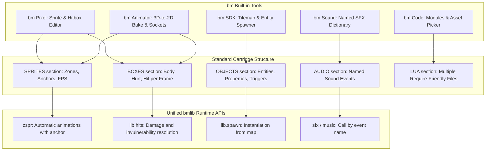

# Analysis of bm Game Architecture and Native Development Limits

This document analyzes the technical architecture of the games developed so far for the **bm** console, extracts the recurring structural patterns and assesses the feasibility of development **exclusively with the console's built-in editors** (`bm SDK`, `bm Pixel`, `bm Code`, `bm Animator`, `bm Studio`, `bm Mesh`, `bm Sound`).

Finally, it proposes a **standard unified structure** to simplify the production of complex games, referring to detail documents for each suite in `/docs/progress/`.

---

## 1. Analysis of the Games Produced So Far

The cartridge catalog (`carts/` and `video/`) shows several technological and structural archetypes:

| Game / Project | Genre | Resolution & Style | Code Architecture | Graphics Pipeline & Animations |
|---|---|---|---|---|
| **Titan Clash** (`carts/titan`) | 2D Versus fighter | 640×360 (and 360×360 on `.b16`) | Modular multi-file (11 Lua files concatenated via `build.py`) | Orthographic 3D pre-rendering with solids and skeleton (`mkrobot.py`), automatic hitbox/hurtbox computation from bones |
| **Yharnam** (`carts/yharnam`) | Gothic 3/4 Action RPG | 360×360 (RGB30 panel) | Procedural monolith (5573 lines in `main.lua`) | Procedural SDF 3D pre-rendering (`mkassets.py`), over 5000 frames across 8 directions, Hermite curves, chunked CSV map streaming |
| **Skyvale World** (`video/`) | 16-bit 2D Platformer | 640×360 | Sequential, tutorial-style (`lib.tiles`, `lib.step`) | Hand-made pixel art in bm Pixel (`skyvale.bm`), tiles and multi-layer maps in the SDK, collision flags |
| **Star Shooter** (`carts/shooter`) | Wave-based shmup | 640×360 | Monolith (339 lines) | Inline procedural: sprites generated at runtime from text strings with `sset()`, no PNG |
| **Astro Wing** (`carts/astrowing`) | Flat 3D space simulator | 640×360 | Monolith (643 lines) | 3D meshes procedurally generated in code (mathematical `builder()`, tetrahedra and cuboids) |

---

## 2. Common Elements and Recurring Architectural Patterns

Despite the diversity of genres, all well-structured games share the following components:

### A. Game Loop and Main State Machine (State Pattern)
All games implement `_init()`, `_update()` and `_draw()`, delegating the flow to a central state variable:
```lua
local state = "title" -- "title", "play", "pause", "gameover", "victory"

function _update()
  if state == "title" then update_title()
  elseif state == "play" then update_play()
  elseif state == "gameover" then update_gameover() end
end
```

### B. Entity Structure (Entity State Table)
Entities (player, enemies, projectiles, particles) share a unified table structure:
- **Position & Physics**: `x, y, vx, vy, w, h, ground, facing`
- **Animation & Timers**: `anim, frame, tick, anim_speed, loop`
- **Combat & Hit Points**: `hp, max_hp, invuln, state, swing, team`
- **Collisions**: bounding box and lists of hurtboxes/hitboxes for the current frame.

### C. Attack Phases and Collisions (Startup / Active / Recovery)
In *Titan Clash* and *Yharnam*, every offensive action strictly follows 3 phases:
1. **Startup (Pre-attack)**: the character winds up the blow; vulnerable, no active hitbox.
2. **Active (Impact)**: the `hitbox` appears (or the projectile is spawned); collision is computed against the opponent's `hurtbox`es.
3. **Recovery (Return)**: the blow retracts; the character cannot move until the recovery frames end.

The bm engine natively supports this pattern through the combination of:
- **`zboxes(animation_name, frame)`**: returns the `body`, `hurt` and `hit` boxes.
- **`bmlib.hits()`**: frame accumulator that handles teams (`team`), damage and unique attack IDs, so that a prolonged slash does not deal multiple damage in the same blow.

### D. Audio Pipeline: SFX Priority and Channels
All games split the 8 voices of the bm synthesizer:
- **Voices 0–2**: high-priority immediate sound effects (hits, jumps, lasers, impacts).
- **Voices 3–7**: ambient music, arpeggios or polyphonic organ progressions (`note(voice, hz, len, wave, vol)` or `music()`).

---

## 3. What Is Achievable Using ONLY the bm Editors on the Console

If a developer decides to build a game **without any PC, without Python and without external scripts**, relying solely on the console's native interface with keyboard and gamepad:

### What Is Perfectly Feasible Natively
1. **2D Platformer (Mario/Sonic/Skyvale style)**:
   - Drawing the sprite sheet in **bm Pixel**.
   - Composing levels with 8×8 or 16×16 tiles and solidity flags in **bm SDK** (page F3).
   - Writing jump physics, coin collection and enemies with `lib.tiles` and `lib.step` in **bm Code**.
   - Creating tracks and effects in **bm Sound**.
2. **Top-Down Shooter / Shmup / Puzzle Game**:
   - Managing ship and projectile tables directly in code.
   - Standard AABB collision tracking.
3. **Low-Poly 3D Dioramas and Explorations (3D models with `model()`)**:
   - Modeling houses, trees and furniture with blocks/tiles in **bm Studio**.
   - Rigging the character skeleton in **bm Animator** (page F2 **rig**).
   - Walk/wave animation with keyframes in **bm Animator** (page F3 **animate**).
   - Display with `model()`, `animate()` and `draw3d()` in bm Code.

---

## 4. Where the Severe Limits Hit (The "Hand Development Wall")

When trying to build complex games like *Yharnam* or *Titan Clash* solely with the console's current tools, critical limits emerge:

### 1. The Wall of Multidirectional and Complex Animations
- In *Yharnam*, the Hunter has 8 directions for dozens of actions (walk, roll, cleaver slash, pistol shot, weapon extension, visceral attack, death). This produces **thousands of frames**.
- Hand-drawing every direction in bm Pixel while keeping proportions, lighting and anatomical consistency takes months of work and is practically impossible to keep consistent without a parametrized 3D view.
- Although **bm Animator** has the F4 Sprites function, it does not automatically generate the named `SPRITES` zones with their foot anchors for 8 directions at once.

### 2. No Visual Editor for Hitboxes / Hurtboxes
- Currently a cartridge's `BOXES` section must be written by hand in a `sprites.txt` text file or defined manually in Lua code tables:
  ```text
  pugno 0 64 32 32 4 12
    hurt * 8 2 16 30
    hit  3 24 10 10 6
  ```
- Doing this "by eye" or measuring pixels with a ruler is extremely slow and error-prone. In bm Pixel hitboxes can only be displayed (toggle `j`), not drawn or edited interactively frame by frame.

### 3. Handling Monolithic Code in bm Code
- **bm Code** manages tabs of different cartridges, but does not readily support a **multi-module** structure within the same project without external concatenation scripts (like `build.py` in Titan Clash).
- Result: projects like *Yharnam* end up with a single **5,500-line** Lua file, hard to navigate, maintain and debug on the console.

### 4. Placement of Entities and Parameters on the Map
- In **bm SDK** (map page F3), the map handles matrices of cell numbers and flags 0–7.
- There is no visual **Entity Layer / Spawner** to place enemies, triggers, lamps and doors with configurable properties (e.g. `type: "beast", hp: 120, patrol: [x1, x2]`). In *Yharnam* this forced the creation of a special fake tile (`placeholders` >= 1024) later decoded via code.

---

## 5. How a Common Structure Across the Suites Can Ease Development

To let anyone build games at the level of Titan Clash or Yharnam working only from the editors, the bm suite needs a shared standard architecture:



With this scheme:
1. Assets export structured, standardized metadata (`SPRITES`, `BOXES`, `ENTITIES`).
2. Lua code no longer has to contain thousands of hardcoded rigid coordinates, but just calls the unified `bmlib` APIs.
3. The workflow between drawing, animation, level assembly and scripting becomes continuous and bidirectional.

---

## 6. Index of Per-Suite Deep-Dive Documents

The specific details, current technical gaps and evolution proposals for each suite are split across the following documents:

- [`docs/progress/suite-pixel.md`](suite-pixel.md): Evolution of **bm Pixel** (timeline, visual hitbox/hurtbox editor, anchor and rotation handling).
- [`docs/progress/suite-sdk.md`](suite-sdk.md): Evolution of **bm SDK** (Object Inspector, entity/trigger layer, room/chunk streamer).
- [`docs/progress/suite-code.md`](suite-code.md): Evolution of **bm Code** (native multi-file projects, interactive asset picker, runtime state inspection).
- [`docs/progress/suite-animator.md`](suite-animator.md): Evolution of **bm Animator** (automatic `BOXES` export from bones, multidirectional batch bake, timeline event markers).
- [`docs/progress/suite-studio-mesh.md`](suite-studio-mesh.md): Evolution of **bm Studio** and **bm Mesh** (low-poly collider generation, modular prefabs for scenery).
- [`docs/progress/suite-sound.md`](suite-sound.md): Evolution of **bm Sound** (named audio event dictionary, pitch/volume randomization, synchronization with animations).

Input standard for games (logical actions on buttons, RGB30 and Pi): [`games-input-standard.md`](games-input-standard.md).

## 7. The Gameplay Kit in `bmlib`

Section 5 asks for one standard structure. `bmlib` now gives the code side of it. A game keeps
only its rules and its drawing:

| Pattern of section 2 | Kit |
|---|---|
| A. Game loop and state machine | `lib.states` (`go`, `push`, `pop`) |
| B. Entity table (position, speed, hp, team, timers) | `lib.world` (kinds, `spawn`, `load`, `update`, `draw`) |
| C. Attack phases and collisions | `lib.hits` for frame data; `W:fight()` for contact damage |
| Input | `lib.input` (the standard actions of [`games-input-standard.md`](games-input-standard.md)) |
| Tweens, timers, scripts | `lib.tween`, `lib.after`, `lib.every`, `lib.script` |
| Sound | `lib.sounds` (named events, tunes) |
| Record and save | `lib.best`, `lib.store` (slot 1); `lib.slots` (games in progress, slots 2 to 8) |

The test game `tests/gamekit/cart.lua` ("gate") uses all of it. It has no entity loop, no
collision loop, no state switch and no timer of its own. `make test-gamekit` runs it with
`bmhost` and a script of presses; the QEMU test `test_game_kit` runs its kit checks on the ARM.

Cost: `W:update()` and `W:draw()` make no table. `W:fight()` compares each attacker with each
target (n times m, no table); a game with hundreds of bullets and hundreds of targets splits
its entities in two worlds or checks fewer pairs. Not measured on the Pi Zero W.

Pong (`carts/pong`) runs on the kit: the two paddles and the ball are `lib.world` entities and
all its notes and tunes are `lib.sounds` events. `make test-game-trace` plays it with a script of
presses and compares a digest of every frame (what it draws, plays and saves) with the digest
made before the move (`tests/gamekit/pong1.golden`, `pong2.golden`). They are equal. The same
test works for the next game: add the tail `tests/gamekit/trace_tail.lua` to its `main.lua`.
`tests/gamekit/cart.lua` checks `lib.sounds` and `lib.slots` (host and ARM).

Not done yet: spawn from an OBJECTS section of the cartridge. It needs a format change: a new
section number in `bm.h`, a reader in `format.c` and `runtime.c`, a writer in `mkbm.py` and
`bmres.py`, and an editor to place the objects. `W:load` takes the rows as data today.
